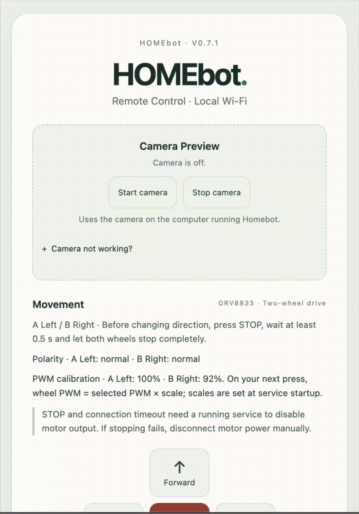
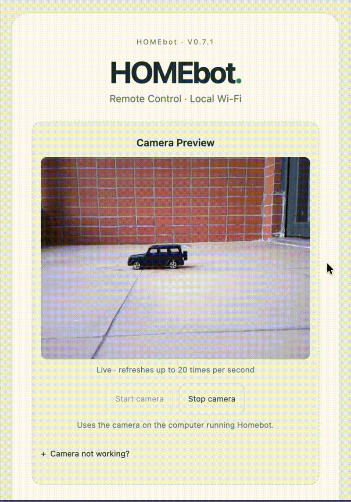
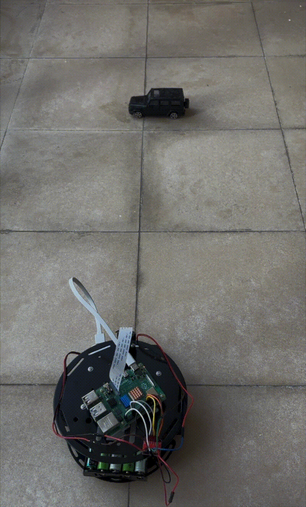

# Homebot

[English](README.md) | 简体中文

Homebot 是一个基于树莓派的家庭机器人项目，用于远程控制、视频监控和自主机器人实验。

当前版本：**v0.7.1**

---

## 运行演示

<table>
  <tr>
    <td align="center"><b>前端页面控制</b></td>
    <td align="center"><b>小车视角</b></td>
    <td align="center"><b>第三人称视角</b></td>
  </tr>
  <tr>
    <td></td>
    <td></td>
    <td></td>
  </tr>
</table>

当前功能：

- 浏览器远程控制
- 通过本地 Wi-Fi 使用手机控制
- 摄像头预览
- 双电机驱动
- 左右电机独立 PWM 校准
- 心跳与看门狗超时停止
- 无需硬件的虚拟电机开发模式

---

## 快速开始

### 安装

```bash
git clone https://github.com/wavesye/HomeBot.git
cd HomeBot

python3 -m venv .venv
source .venv/bin/activate

pip install -r requirements.txt
```

### 在电脑上运行

```bash
python -m server.run
```

在浏览器打开：

```text
http://localhost:8000
```

默认使用虚拟电机，无需树莓派即可运行。

### 在树莓派上运行

```bash
python -m server.run --lan --motor drv8833-dual
```

使用树莓派 CSI 摄像头时：

```bash
python -m server.run \
  --lan \
  --motor drv8833-dual \
  --camera picamera2
```

---

## 工作原理

```text
浏览器
   │
   ▼
JavaScript
   │
   │ HTTP
   ▼
FastAPI
   │
   ▼
电机控制器
   │
   ▼
树莓派 GPIO
   │
   ▼
DRV8833
   │
   ├── 左电机
   └── 右电机
```

一次移动指令的处理流程：

```text
前进
   ↓
POST /api/move
   ↓
FastAPI
   ↓
电机控制器
   ↓
DRV8833
   ↓
电机
```

机器人移动期间，浏览器会周期性发送心跳。

```text
移动
 ↓
command_id
 ↓
心跳
 ↓
看门狗
 ↓
心跳丢失
 ↓
停止
```

浏览器断开连接或心跳停止后，后端会自动停止电机输出。

### 项目结构

```text
HomeBot/
├── server/
│   ├── main.py       # API、控制状态与看门狗
│   ├── run.py        # 服务启动
│   ├── camera.py     # 摄像头
│   ├── motor.py      # 电机抽象
│   ├── drv8833.py    # 单电机驱动
│   └── drive.py      # 双电机控制
│
├── web/
│   ├── index.html
│   ├── style.css
│   └── app.js        # 控制、心跳与摄像头
│
├── tests/
├── docs/             # 本地文档，不纳入 Git
├── README.md
└── README.zh-CN.md
```

---

## 硬件配置

### 硬件清单

| 部件 | 选择 | 用途 |
| --- | --- | --- |
| 主控电脑 | Raspberry Pi 4B | 运行 Homebot 后端 |
| 电机驱动 | DRV8833 | 驱动两台直流电机 |
| 电机 | 2 台直流减速电机 | 差速驱动 |
| 摄像头 | 树莓派 CSI 摄像头 / USB 摄像头 | 视频预览 |
| 树莓派电源 | USB 充电宝 | 为树莓派供电 |
| 电机电源 | AA 电池组 | 独立为电机供电 |
| 底盘 | 两轮机器人底盘 | 机器人平台 |

树莓派与电机分别供电，树莓派与 DRV8833 必须共地。

### 接线

基本结构：

```text
树莓派 4B
   │
   ├── GPIO ────────── DRV8833 控制输入
   └── GND ─────────── DRV8833 GND

电机电源 ───────────── DRV8833 VM
                           │
                           ├── AOUT1 / AOUT2 ── 左电机
                           └── BOUT1 / BOUT2 ── 右电机
```

供电结构：

```text
USB 充电宝
      │
      ▼
树莓派

AA 电池组
      │
      ▼
DRV8833
      │
      ├── 左电机
      └── 右电机

树莓派 GND ───── DRV8833 GND
```

摄像头连接：

```text
树莓派
     │
     │ CSI
     ▼
摄像头模块
```

详细 GPIO 针脚分配与硬件测试流程保存在本地文档中，不纳入此仓库：

```text
docs/
├── v0.6-bench.md
├── v0.7-drive.md
├── v0.7.1-calibration.md
└── pi-camera.md
```

本 README 仅展示整体硬件结构。为电机通电前，请先取得详细接线文档并按文档操作。

---

## 技术组成

### 软件

- **Python**
- **FastAPI**
- **Uvicorn**
- **HTML / CSS / JavaScript**
- **OpenCV**
- **Picamera2**

### 硬件

- **树莓派**
- **DRV8833**
- **GPIO Zero / lgpio**
- **CSI / USB 摄像头**
- **直流减速电机**

### 核心概念

Homebot 当前使用的机制，也将用于后续自主控制：

```text
REST API
电机抽象
心跳
看门狗
控制代次（Control epoch）
摄像头输入
PWM 电机控制
```

网页界面、控制逻辑与硬件驱动相互分离，便于后续使用更高层的控制算法替换手动控制。

---

## 后续计划

```text
远程控制
      ↓
摄像头
      ↓
双电机驱动
      ↓
PWM 校准
      ↓
视频流
      ↓
计算机视觉
      ↓
自主驾驶
      ↓
导航
```
